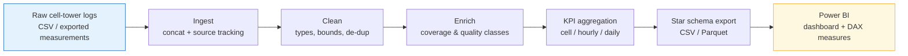

# 5G NR Network KPI and Performance Dashboard

A Python / Pandas pipeline that turns raw cell-tower measurement logs into a
clean, validation-checked **star schema**, then feeds a **Power BI** dashboard
for 5G NR coverage, capacity and reliability analysis.


---

## Overview

Raw RAN logs are messy: duplicate samples, out-of-range readings, missing
timestamps and inconsistent types. This project takes those logs and produces
analysis-ready tables that answer the questions a radio network engineer
actually cares about:

- **Coverage** — where is RSRP weak, and what share of samples fall in the poor bucket?
- **Quality** — how are SINR, RSRQ and CQI distributed per cell?
- **Capacity** — what throughput and PRB utilisation are cells delivering?
- **Reliability** — what are accessibility, handover success and drop rates?
- **Health** — which cells need attention, ranked by a composite compliance score?

Everything is reproducible from a single command, and the Power BI model is
documented as code (`powerbi/kpi_measures.dax`) so the report can be rebuilt
from scratch.

## Architecture



## Repository layout

```
.
├── src/kpi_pipeline/          # installable Python package
│   ├── config.py              # paths + KPI thresholds
│   ├── ingest.py              # load & concatenate raw logs
│   ├── clean.py               # validation and cleaning
│   ├── kpis.py                # derived columns + aggregations
│   ├── export.py              # star-schema writer
│   └── cli.py                 # `python -m kpi_pipeline.cli`
├── scripts/
│   ├── generate_sample_data.py  # realistic synthetic logs
│   └── run_pipeline.py          # run without installing
├── tests/                     # pytest unit + end-to-end tests
├── powerbi/
│   ├── kpi_measures.dax       # DAX measures for the report
│   └── README.md              # data model + visual spec
├── docs/kpi_definitions.md    # KPI formulas and thresholds
├── data/                      # raw / processed / sample (git-ignored)
└── .github/workflows/ci.yml   # lint + tests + pipeline smoke test
```

## Quickstart

Requires Python 3.10+.

```powershell
# 1. Create and activate a virtual environment
py -m venv .venv
.\.venv\Scripts\Activate.ps1

# 2. Install
pip install -r requirements-dev.txt
pip install -e .

# 3. Generate a realistic synthetic dataset (no real data needed)
python scripts/generate_sample_data.py --rows 50000

# 4. Run the pipeline
python -m kpi_pipeline.cli --format csv,parquet

# 5. Test
pytest
```

On macOS / Linux the only difference is activation:
`source .venv/bin/activate`.

### Use your own logs

Drop CSV exports into `data/raw/` (any filename) and run:

```powershell
python -m kpi_pipeline.cli --raw-dir data/raw --out-dir data/processed
```

Required columns: `timestamp`, `site_id`, `cell_id`, `rsrp_dbm`, `sinr_db`,
`rsrq_db`. Optional columns such as `cqi`, `mcs_dl`, throughput, PRB
utilisation and event flags are picked up automatically when present.

## Outputs

`data/processed/` after a run:

| Table | Grain | Purpose |
|---|---|---|
| `fact_signal_samples` | one UE measurement | main fact table for slicing |
| `dim_cell` | one row per cell | site / band / PCI / ARFCN dimension |
| `agg_cell_kpis` | one row per cell | headline KPI table |
| `agg_cell_hourly` | cell × hour | time-series visuals |
| `agg_cell_daily` | cell × day | trend lines |

Example — top of the per-cell KPI table:

| cell_id | samples | avg_rsrp_dbm | avg_sinr_db | accessibility_pct | drop_rate_pct | compliance_score |
|---|---|---|---|---|---|---|
| CELL-001-1 | 4,182 | −83.4 | 13.9 | 99.6 | 1.8 | 86.2 |
| CELL-002-1 | 4,051 | −86.1 | 12.2 | 99.2 | 2.3 | 82.7 |

(Sample values from the synthetic generator.)

## KPI coverage

| Area | KPIs |
|---|---|
| Coverage | RSRP (mean, P10), good/poor coverage %, coverage class |
| Quality | RSRQ, SINR, CQI, MCS, quality class |
| Capacity | DL/UL throughput, PRB utilisation DL/UL, latency |
| Reliability | Accessibility %, handover success %, drop rate % |
| Health | Composite compliance score (0–100) + status band |

Full formulas and thresholds: [`docs/kpi_definitions.md`](docs/kpi_definitions.md).

## Power BI dashboard

The Python pipeline writes the model; Power BI visualises it. See
[`powerbi/README.md`](powerbi/README.md) for the relationship setup and report
pages, and [`powerbi/kpi_measures.dax`](powerbi/kpi_measures.dax) for ready-to-
paste measures (accessibility, drop rate, good coverage, compliance score,
traffic-light status).

Suggested pages:

1. **Network overview** — KPI cards, RSRP by site, throughput by hour.
2. **Cell performance** — SINR vs throughput scatter, cells ranked by score.
3. **Coverage & quality** — RSRP histogram, coverage share, hour × cell heatmap.

## Data quality rules

The cleaning stage deliberately rejects or repairs bad data instead of silently
propagating it:

- unparseable timestamps and missing cell identity are dropped;
- numeric columns are coerced and clipped to physical bounds;
- duplicate `(timestamp, cell_id, ue_id)` measurements are collapsed;
- event flags are normalised to 0/1;
- rate KPIs return `null` on a zero denominator rather than a fake 0 %.

## Testing & CI

- `pytest` — unit tests for derived columns, KPI maths, zero-denominator
  handling, cleaning rules, plus an end-to-end export test.
- GitHub Actions runs `ruff`, `pytest`, then a full pipeline smoke test on
  every push and pull request.

## Roadmap

- [ ] Parquet-only incremental loads for large log volumes
- [ ] Anomaly detection on per-cell KPI time series
- [ ] Automated PDF/Excel KPI report export
- [ ] Timezone-aware handling for multi-region operators

## License

MIT — see [LICENSE](LICENSE).
